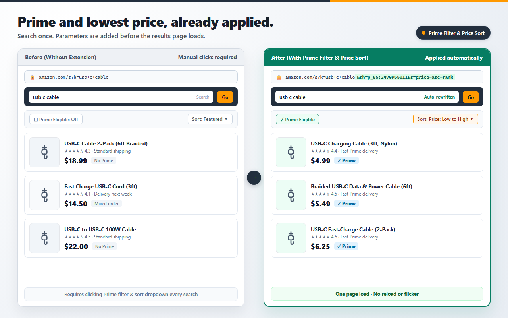
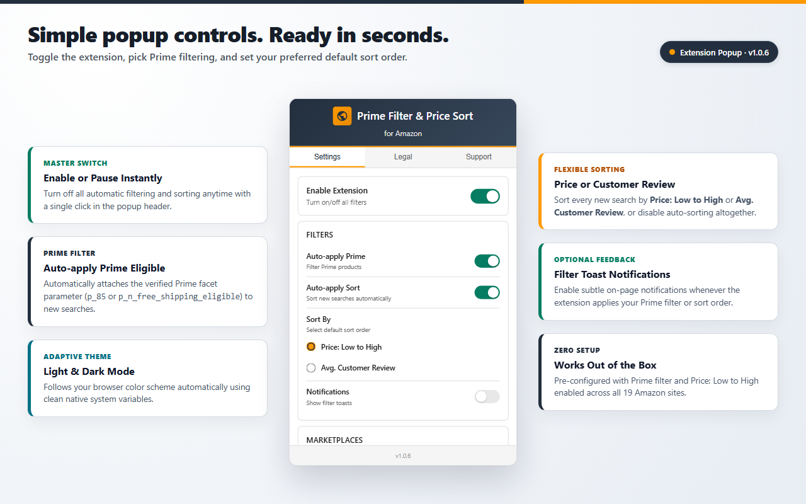
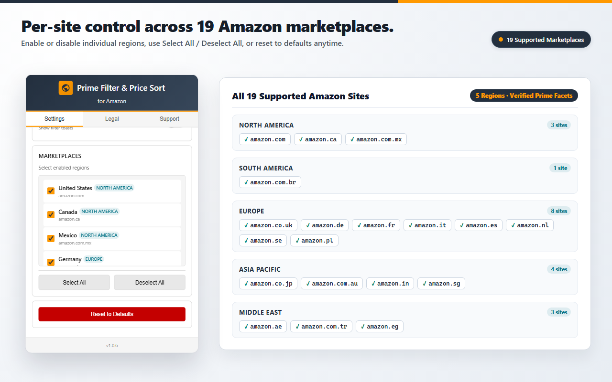
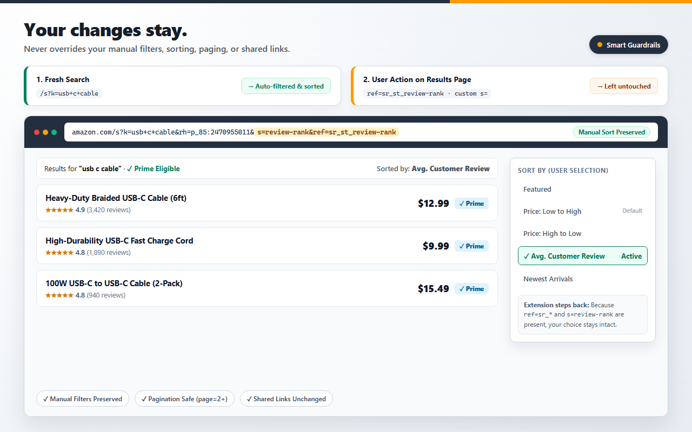
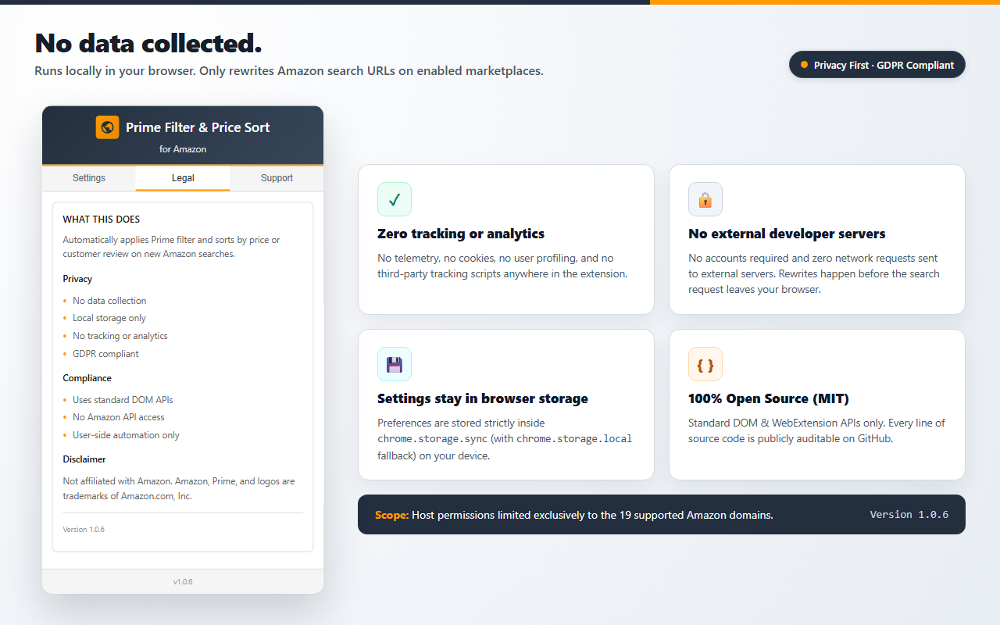

# Prime Filter & Price Sort for Amazon

Applies the Amazon Prime filter and your sort order to every new Amazon search, before the page loads. Sort by lowest price or best reviews. One page load, no tracking.

[Firefox: Get the add-on](https://addons.mozilla.org/en-US/firefox/addon/amazon-all-prime-sort-price/) | [Chrome: Get the extension](https://chromewebstore.google.com/detail/prime-filter-price-sort-f/bncbmleiffadkeekjdgcofccdbpmbldl) | [Edge: Get the add-on](https://microsoftedge.microsoft.com/addons/detail/prime-filter-price-sort/mhndpkgjdillpomodinlbhicpocloemf)

I got tired of clicking the same two things on every Amazon search: the Prime filter and "sort by price". This extension does it for me.

## What it does
- **Prime filter:** shows only Prime eligible items ("Prime only").
- **Sorting (optional):** sort by lowest price (low to high) or sort by best reviews. You can turn sorting off.
- **One page load:** the parameters are added to the search request before it is sent, so there is no reload and no flicker.
- **Respects your choices:** if you change a filter or the sort order on the results page, the extension leaves it alone. A sort order in a shared link is never overridden.
- **Per site control:** pick the Amazon sites it should work on.
- **Dark mode** that follows your browser theme.

## Supported Amazon sites
Works on all 19 Amazon sites, including the Prime filter.

| Region | Sites |
|---|---|
| North America | amazon.com, amazon.ca, amazon.com.mx |
| South America | amazon.com.br |
| Europe | amazon.co.uk, amazon.de, amazon.fr, amazon.it, amazon.es, amazon.nl, amazon.se, amazon.pl |
| Asia Pacific | amazon.co.jp, amazon.com.au, amazon.in, amazon.sg |
| Middle East | amazon.ae, amazon.com.tr, amazon.eg |

Amazon changes its pages now and then. If something stops working on your Amazon site, please [open an issue](https://github.com/codingismynewgaming/prime-filter-price-sort-for-amazon/issues).

## Install
- **Firefox:** [addons.mozilla.org](https://addons.mozilla.org/en-US/firefox/addon/amazon-all-prime-sort-price/), then "Add to Firefox". Firefox 140 or newer (Android 142 or newer).
- **Chrome:** [Chrome Web Store](https://chromewebstore.google.com/detail/prime-filter-price-sort-f/bncbmleiffadkeekjdgcofccdbpmbldl), then "Add to Chrome".
- **Edge:** [Microsoft Edge Add-ons](https://microsoftedge.microsoft.com/addons/detail/prime-filter-price-sort/mhndpkgjdillpomodinlbhicpocloemf), then "Get".
- **From source (Firefox):** clone the repo, open `about:debugging#/runtime/this-firefox`, choose "Load Temporary Add-on", select `manifest.json`.
- **From source (Chrome / Edge local dev build):** run `node scripts/build-chromium.mjs all` and load the generated folder from `../builds/chromium/` via `chrome://extensions` or `edge://extensions` (Developer mode). Store packages are not submitted yet; see [docs/chromium-build.md](docs/chromium-build.md).

## Screenshots

### Popup settings

### Per-site marketplace control

### Keeps your manual changes

### Privacy and local storage

## Good to know
Sorting by price from low to high is not the same as finding the cheapest product. Amazon decides what appears in the results, and sponsored items and shipping costs are not part of the sort.

## Privacy
No data collection by the developer, no analytics, no accounts. Settings are saved with browser storage (`chrome.storage.sync` with `chrome.storage.local` fallback). Details: [PRIVACY.md](PRIVACY.md).

## Support
Bugs and ideas: [GitHub issues](https://github.com/codingismynewgaming/prime-filter-price-sort-for-amazon/issues). Security: see [SECURITY.md](SECURITY.md).
If this saves you some clicks, you can support the project: [Buy Me a Coffee](https://buymeacoffee.com/codingiymynewgaming) or [PayPal](https://www.paypal.com/donate/?hosted_button_id=ZXHJFTUW9NQK8).

## Technical details
- **Manifest Version:** 3 (MV3)
- **Firefox (140+, Android 142+):** Rewrites search URLs in the background with `webRequest.onBeforeRequest` (blocking), with `content/content.js` as fallback. Permissions: `storage`, `webRequest`, `webRequestBlocking`, and host permissions for the 19 Amazon sites.
- **Chrome / Edge (local build, Chromium 120+):** Dynamic `declarativeNetRequestWithHostAccess` gate rules route `/s` navigations to local `chromium/gate.html`, compute the target via shared `lib/storage.js` and `lib/rewrite.js`, install a one-time tab-scoped session allow rule, and clean up via observation-only `webRequest` and `alarms`. Permissions: `storage`, `declarativeNetRequestWithHostAccess`, `webRequest`, `alarms`, `web_accessible_resources` (`chromium/gate.html`), and host permissions for the 19 Amazon sites.
- **URL rules:** Prime filter uses the `rh` parameter facet (`p_85` on `.com` and `.ca`, `p_n_free_shipping_eligible` on the remaining sites), and sort uses the `s` parameter. Fresh searches only (`/s` and language-prefixed paths like `/-/en/s`): URLs with `ref=sr_*`, an existing `s`, or an existing Prime facet are left untouched.

## License
MIT, see [LICENSE](LICENSE).

## Disclaimer
This is an independent project. It is not affiliated with, endorsed by, or sponsored by Amazon.com, Inc. Amazon and Prime are trademarks of Amazon.com, Inc. or its affiliates.
